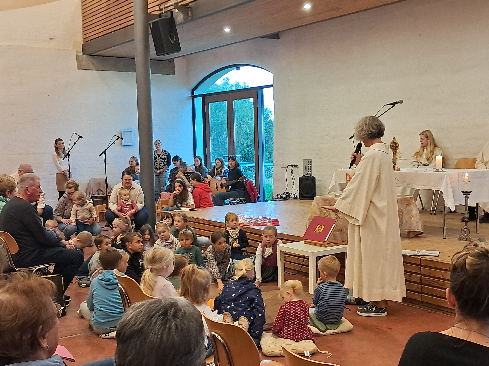
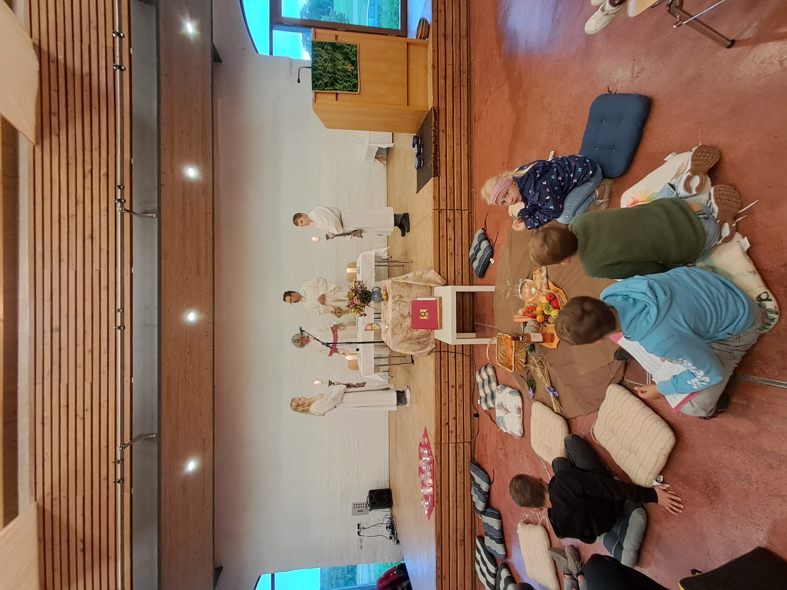

# Erntedankfest mit vielen Kindern

Am 5. Oktober 2025 feierte die Pfarrgemeinde gemeinsam das Erntedankfest. Besonders erfreulich war die rege Teilnahme der Kinder, die den Familiengottesdienst lebendig mitgestalteten und sich rund um den Altar versammelten.

Die musikalische Gestaltung übernahm der **Klangzauber** und verlieh dem Gottesdienst mit seinen Liedern einen festlichen und zugleich familiären Rahmen. Die Erntegaben vor dem Altar erinnerten daran, dankbar auf das zu schauen, was uns im Laufe des Jahres geschenkt wurde.

So wurde das Erntedankfest zu einer schönen Feier für die ganze Pfarrgemeinde.
