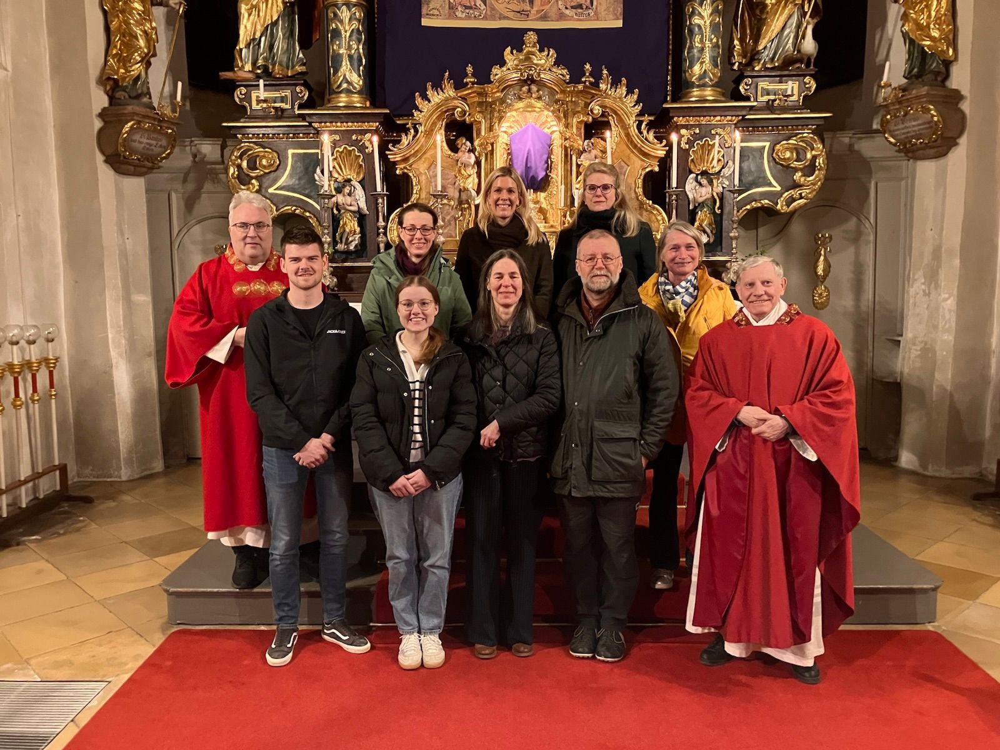

# Neuer Pfarrgemeinderat offiziell vorgestellt

Am 22. März 2026 wurde der neue Pfarrgemeinderat von Oberbergkirchen im Rahmen des Gottesdienstes offiziell vorgestellt.

Dem neuen Gremium gehören Claudia Rude, Roland Lechner, Gerhard Schuster, Marina Neudecker, Waltraud Rosenhuber und Saskia Novak an. Lena Schiller wirkt als Vertreterin der Katholischen Landjugend mit.

Wir wünschen dem neuen Pfarrgemeinderat viel Freude, gute Ideen und Gottes Segen für seine gemeinsame Arbeit.
