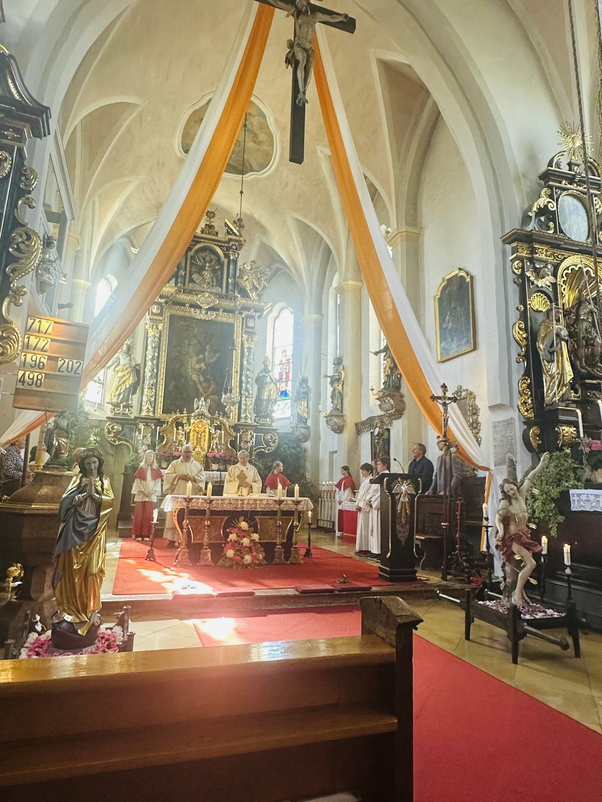
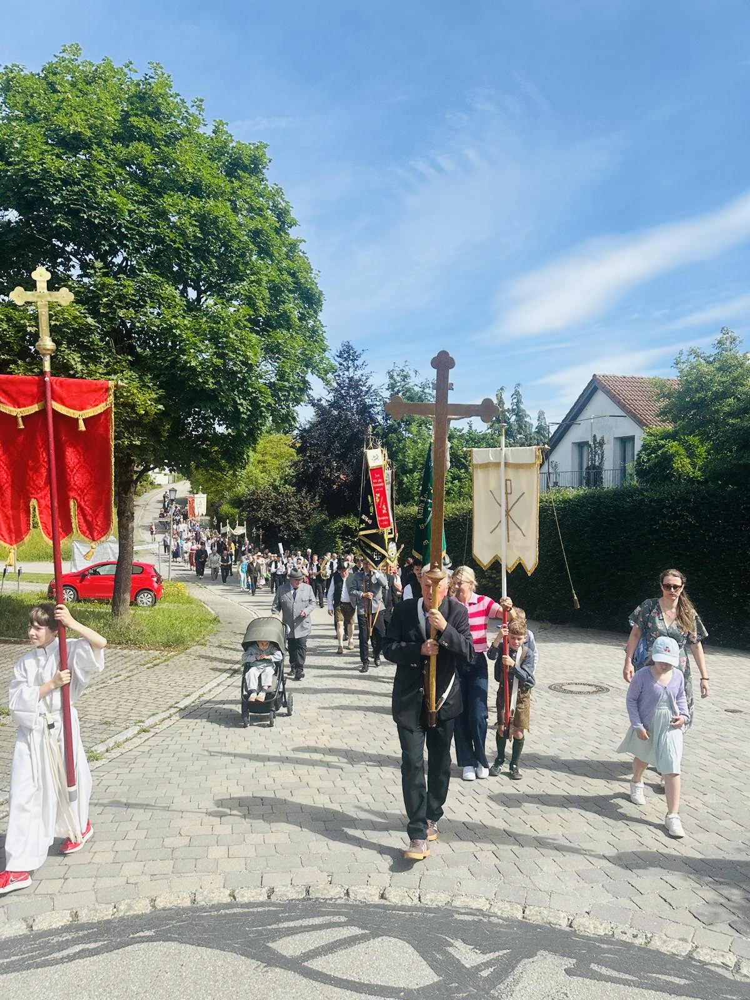
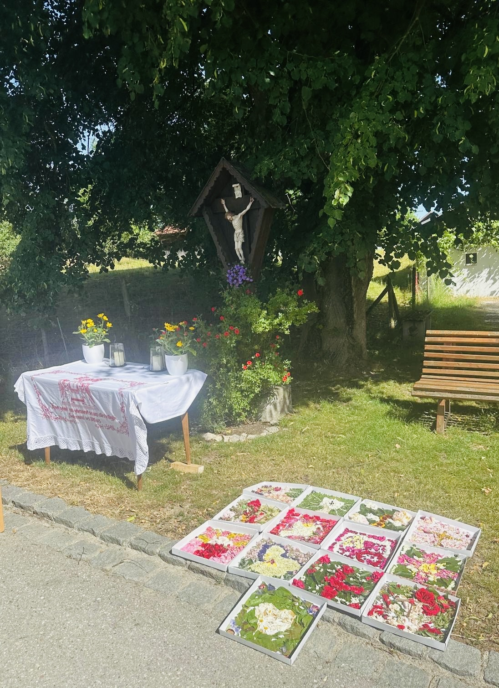

# Gemeinsam im Glauben unterwegs

Am 4. Juni 2026 feierte die Pfarrgemeinde Oberbergkirchen Fronleichnam. Der Pfarrgemeinderat, vertreten durch die Vorsitzende Marina Neudecker, bedankt sich herzlich bei Pfarrer Marek Kalinka und Diakon Clemens Rude für den festlichen Gottesdienst und die Andachten an den einzelnen Stationen.

Besonders erfreulich war die Teilnahme der Katholischen Landjugend, der örtlichen Vereine und des Kirchenchors. Auch die Trägerinnen und Träger der Kreuze, Fahnen und Heiligenfiguren trugen dazu bei, dem Fronleichnamszug einen würdigen und festlichen Rahmen zu geben.

Von der Kirche führte der Weg zunächst zum Hadinger Kreuz, anschließend über den Pfarrhof und die Gemarkung Alter Pfarrhof wieder zurück zur Kirche. Die Freiwillige Feuerwehr war dabei unentbehrlich: Sie sicherte den gesamten Zug und sorgte dafür, dass alle Teilnehmenden sicher unterwegs waren.

Drei schöne Freiluftaltäre, gestaltet von den Familien Haas, Ansorg und Rude, bildeten die Stationen des Glaubensfestes und luden zum gemeinsamen Gebet ein.

Das Fronleichnamsfest zeigte auf eindrucksvolle Weise, wie viele Menschen und Gruppen gemeinsam das kirchliche Leben in Oberbergkirchen tragen.
