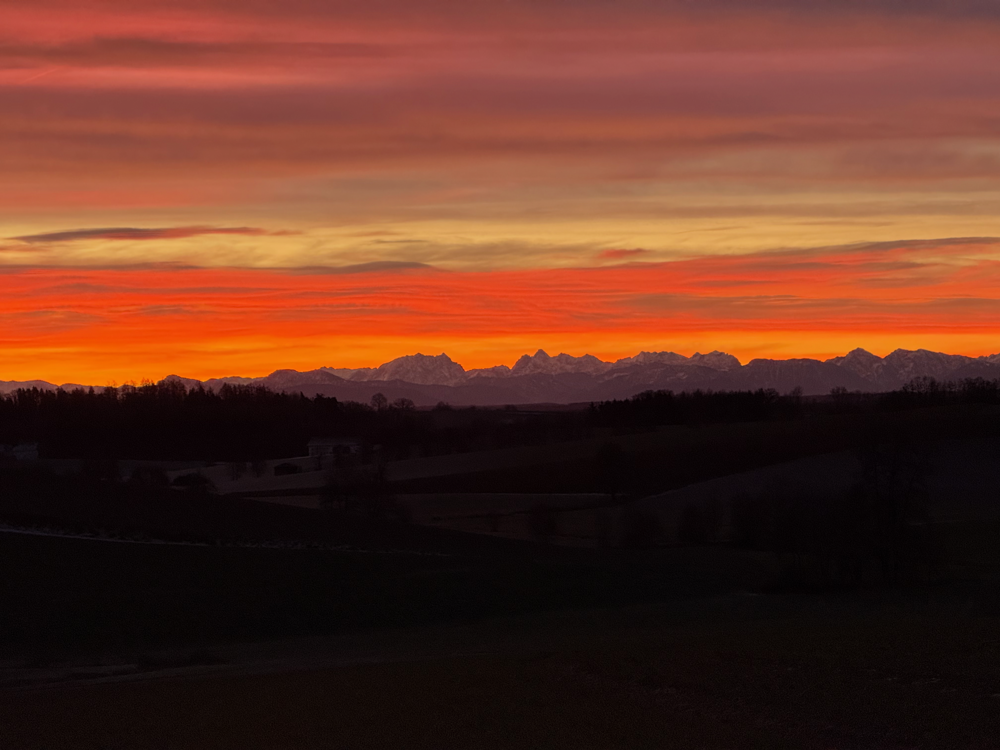

# Wenn der Himmel zum Innehalten einlädt

Manchmal schenkt uns die Natur Augenblicke, die uns für einen Moment den Alltag vergessen lassen. Ein solcher Anblick bot sich über Oberbergkirchen: Der Himmel leuchtete in kräftigem Rot, Orange und Gold, während sich am Horizont die Gipfel der Alpen als dunkle Silhouetten abzeichneten.

Ein beeindruckendes Naturschauspiel, das uns daran erinnert, wie schön und vielfältig Gottes Schöpfung ist.

*Aufnahme vom 25. Januar 2025.*

## Einen Augenblick still werden

In unserem Alltag sind wir oft beschäftigt. Termine, Verpflichtungen und Sorgen bestimmen unsere Gedanken. Da tut es gut, gelegentlich stehen zu bleiben, den Blick in die Ferne schweifen zu lassen und einfach nur zu staunen.

Solche Augenblicke laden uns ein, innezuhalten und dankbar zu sein. Für die Schönheit der Natur, für das Leben und für all das Gute, das uns oft selbstverständlich erscheint.

Vielleicht braucht es manchmal gar nicht viele Worte, um Gott nahe zu sein. Vielleicht genügt ein Blick auf den Abendhimmel und ein stilles Gebet.

## Ein kleines Gebet

*Guter Gott,*

*wenn wir die Schönheit deiner Schöpfung betrachten,*
*lass uns für einen Augenblick still werden.*

*Öffne unsere Augen für die kleinen und großen Wunder,*
*die uns jeden Tag begegnen.*

*Schenke uns Dankbarkeit für das Schöne,*
*Kraft für das Schwierige*
*und Vertrauen für das, was vor uns liegt.*

*Amen.*

---

**Vielleicht ist das die schönste Einladung, die uns die Natur machen kann: kurz stehen bleiben, staunen und Danke sagen.**