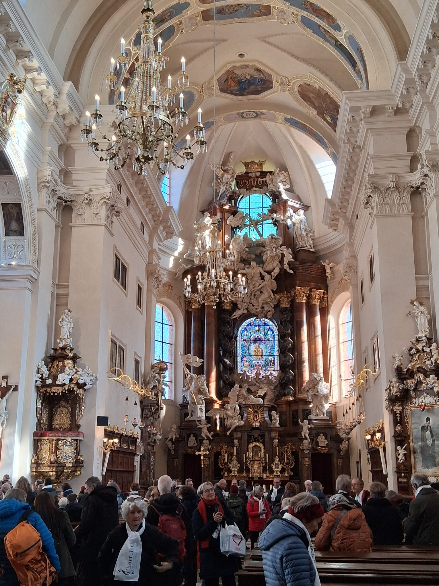
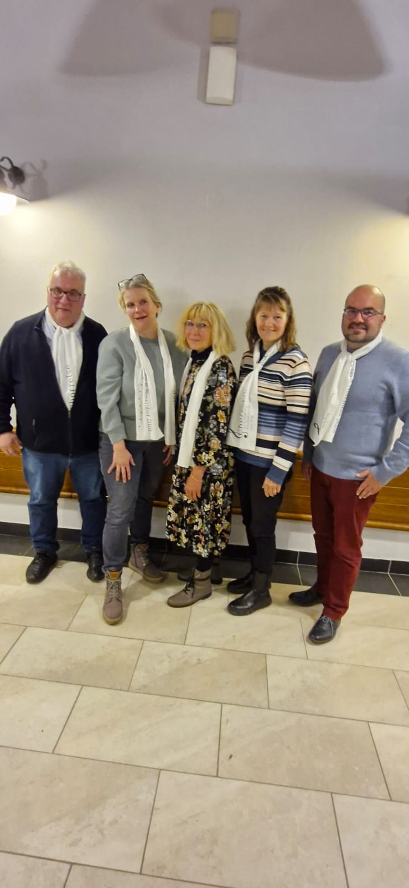
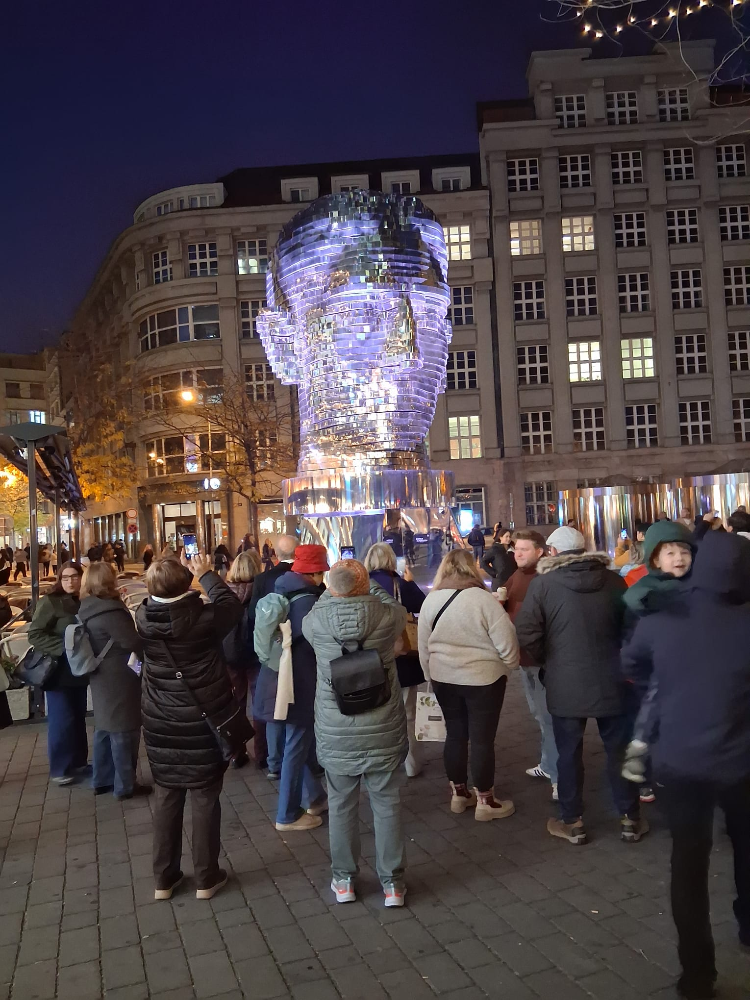
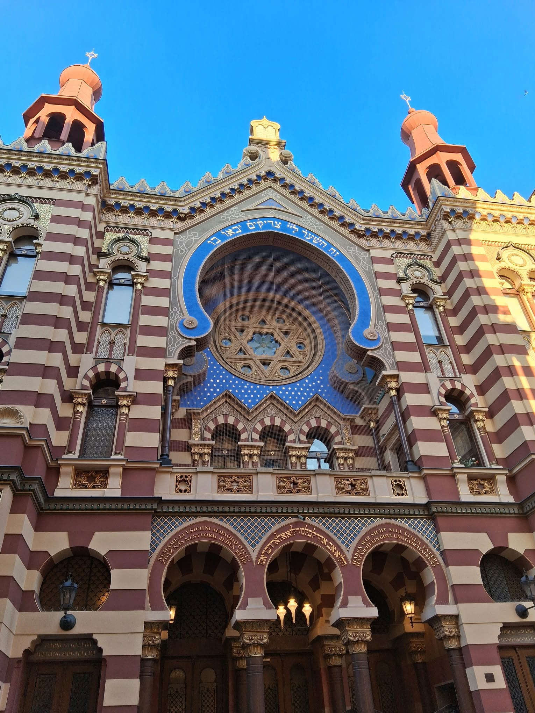
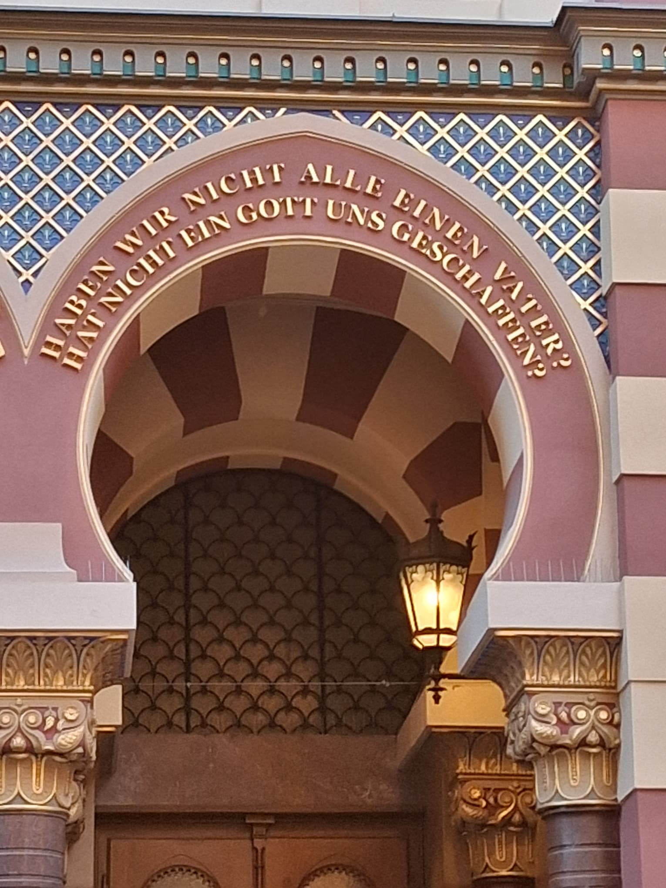
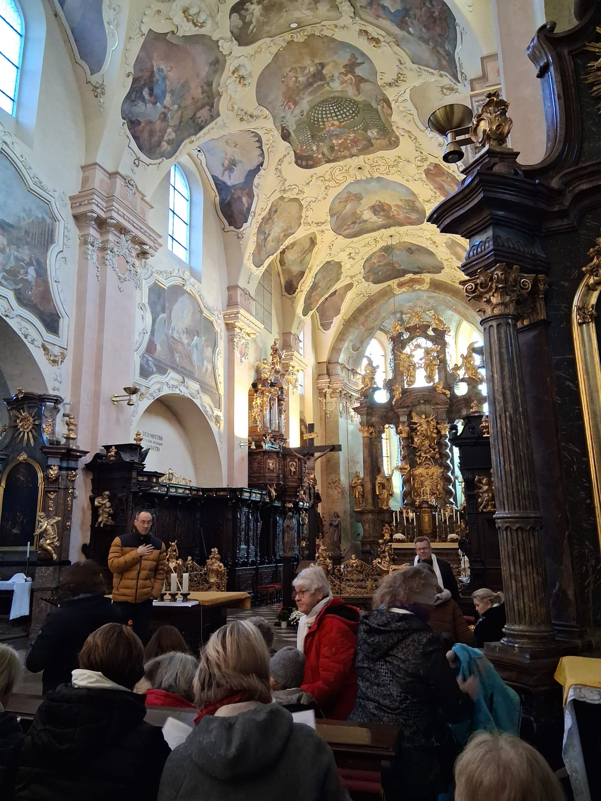

# Chorreise nach Prag

Vom 4. bis zum 8. November 2026 führte die Chorreise des Erzbistums München und Freising nach Prag und an weitere bedeutende Orte in der Umgebung.

Rund 300 Sängerinnen und Sänger sowie Musikerinnen und Musiker richteten sich in der Mariä-Himmelfahrts-Kirche in Alt-Bunzlau, dem heutigen Stará Boleslav, zur gemeinsamen Chorprobe ein.

Auch eine Abordnung des Chores unseres Pfarrverbandes nahm an der Reise teil.

Bei einer Stadtführung durch Prag gehörte auch das eindrucksvolle Kopfmodell Franz Kafkas zu den Stationen.

Zu den weiteren Eindrücken der Reise gehörte die Jerusalemsynagoge mit ihrer farbenreichen Fassade. Ein Detail über dem Eingang trägt die Inschrift: „Haben wir nicht alle einen Vater? Hat nicht ein Gott uns geschaffen?“

Kirchenmusikdirektor Professor Stephan Zippe leitete die Chorprobe vor dem Vesper-Gottesdienst in der Klosterkirche Strahov in Prag. Die gemeinsame Musik in den besonderen Kirchenräumen war ein wichtiger Teil der Reise.

