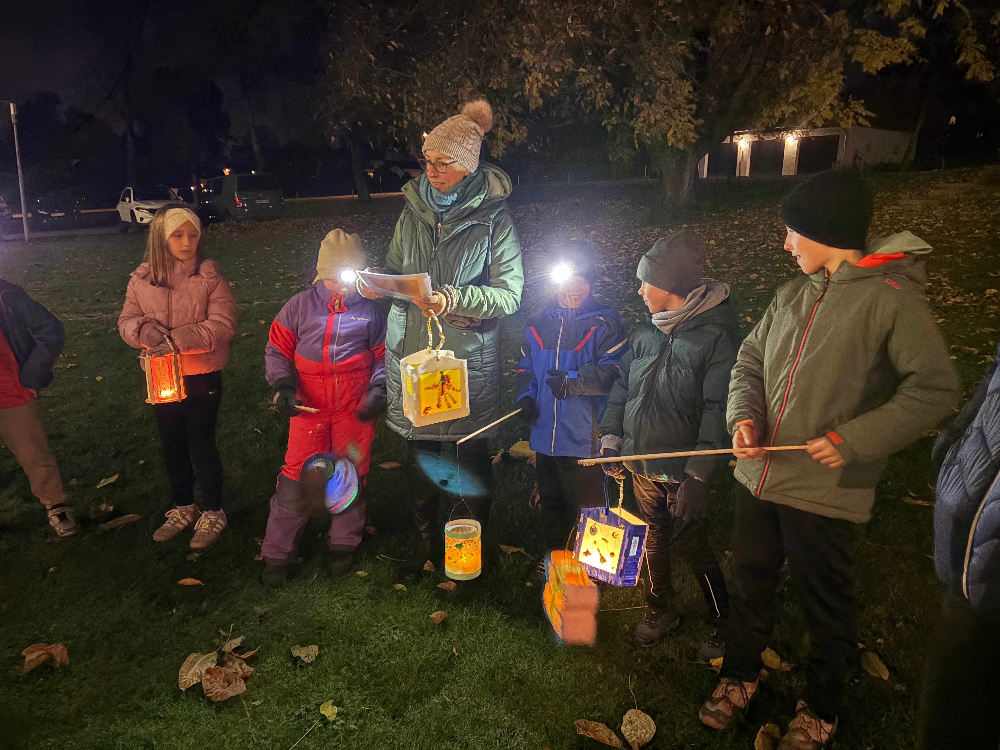
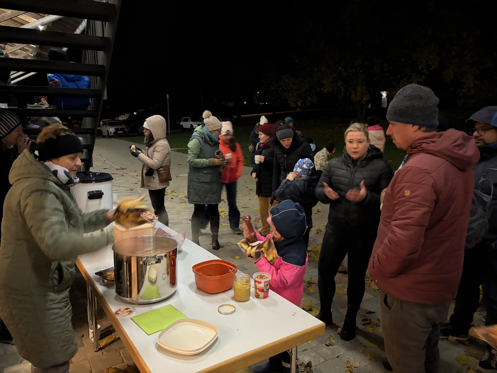

# Lichterprozession in Oberbergkirchen – leuchtende Laternen und fröhliche Kinder

**4. November 2026 | Oberbergkirchen**

Windig und kalt war es bei der diesjährigen Lichterprozession in Oberbergkirchen. Doch davon ließen sich die vielen fröhlichen Kinder und ihre Begleiter nicht die gute Laune verderben.

Mit ihren bunten Laternen brachten die Kinder Licht in den dunklen Novemberabend.

## Wärme und Stärkung nach der Prozession

Nach der Lichterprozession wartete eine willkommene Stärkung auf die Teilnehmer:  Hotdogs. Gerade bei den kalten Temperaturen kam das warme Essen bestens an.

Auch die Feuerschale sorgte für eine gemütliche Atmosphäre und bot Gelegenheit, sich aufzuwärmen und noch ein wenig miteinander zu plaudern.

)

Die Hotdogs fanden jedenfalls reißenden Absatz: **Am Ende war kein einziger mehr übrig!**

## Ein gelungener Abend

Trotz Wind und Kälte war die Lichterprozession ein gelungenes Erlebnis für Kinder und Erwachsene. Die vielen leuchtenden Laternen, die fröhlichen Gesichter und das gemütliche Beisammensein machten den Abend zu einer schönen Erinnerung.

**Ein herzliches Dankeschön an alle, die bei der Vorbereitung, Durchführung und Verpflegung mitgeholfen haben!**