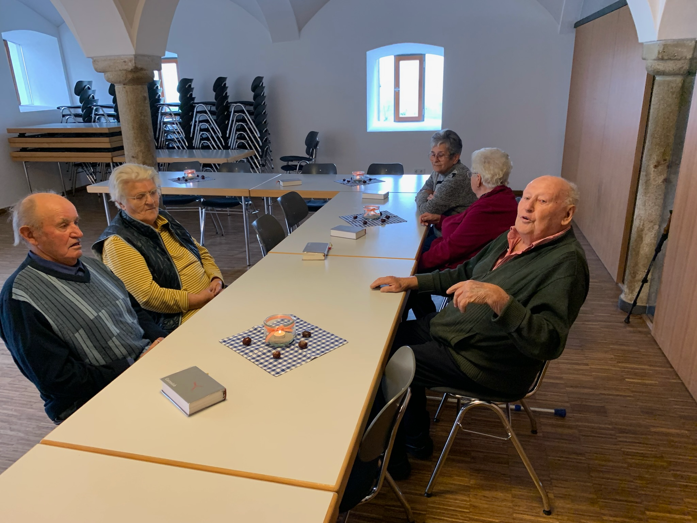
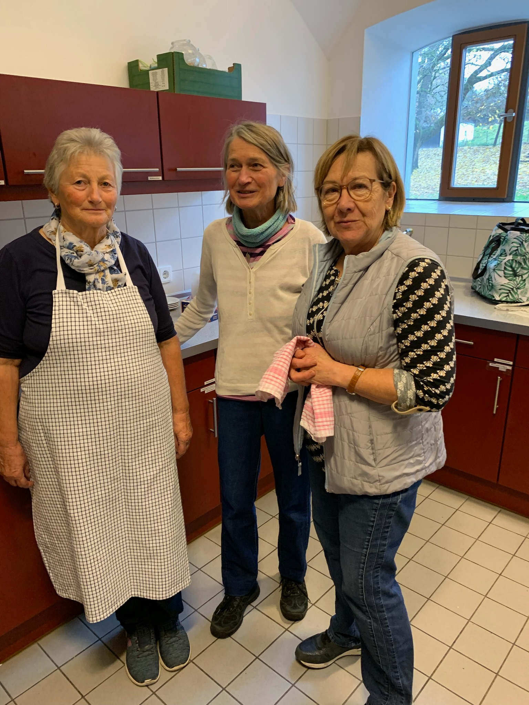
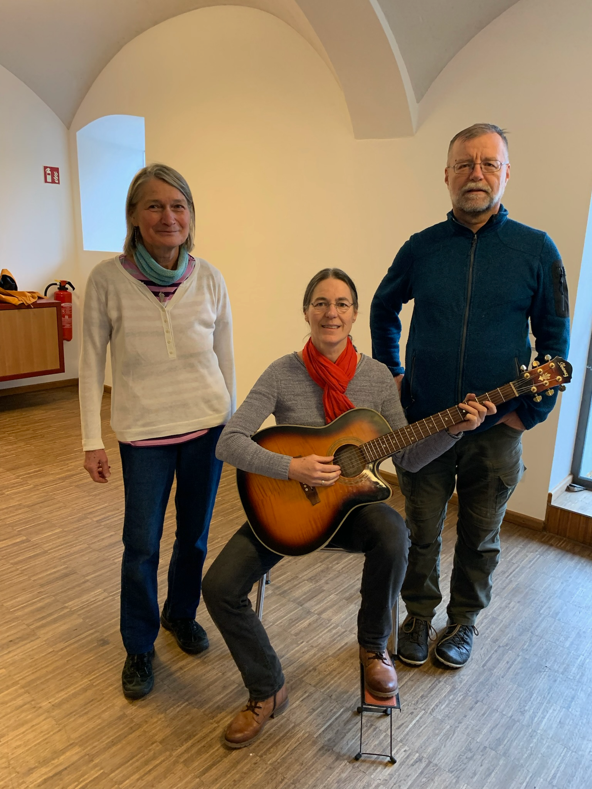
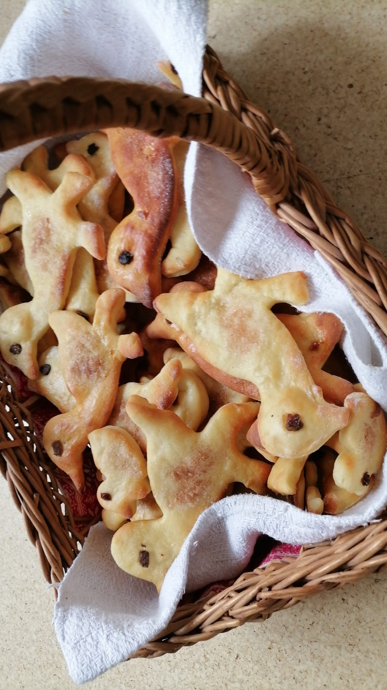

# Seniorennachmittag zu St. Martin

Am 11. November kamen die Seniorinnen und Senioren der Pfarrgemeinde zu einem schönen Nachmittag mit gemeinsamem Gottesdienst, gutem Essen sowie Kaffee und Kuchen zusammen.

Bei Kaffee und Kuchen blieb viel Zeit für Gespräche und ein geselliges Beisammensein.

Das Küchenteam sorgte mit großem Einsatz dafür, dass alle Gäste bestens versorgt waren.

Das Musikteam übernahm die musikalische Gestaltung des Gottesdienstes.

Passend zu St. Martin gab es gesegnete Martinsgänse. Ein besonderer Dank gilt Waltraud Rosenhuber, welche die Martinsgänse gebacken.

Herzlichen Dank an den Pfarrer, das Küchenteam, das Musikteam und alle Gäste, die diesen gelungenen Nachmittag mitgestaltet haben.
