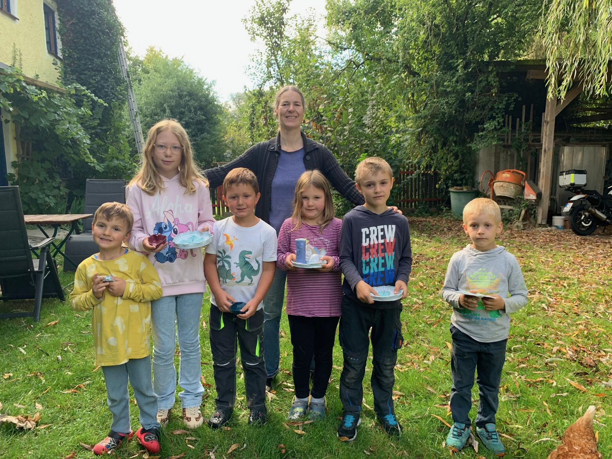
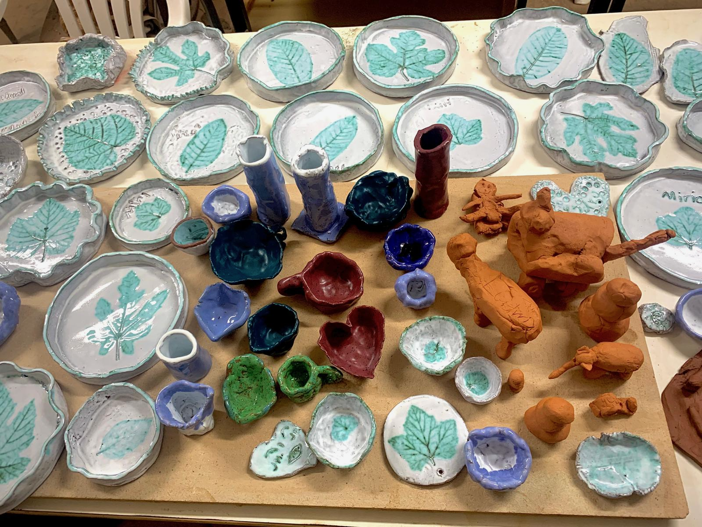

# Ferienprogramm: Kleine Kunstwerke aus Ton

Beim Ferienprogramm wurde mit viel Freude geknetet, geformt und gestaltet. Die Kinder verwandelten den Ton in Schalen, Teller, Figuren und viele ganz persönliche Kunstwerke.

Unter dem großen Baum am Pfarrhof ließ es sich auch an einem warmen Sommertag angenehm arbeiten. Zunächst lernten die Kinder, wie der Ton vorbereitet und gleichmäßig ausgerollt wird.

Danach wurde an den Tischen eifrig geknetet, geformt und verziert. Schritt für Schritt entstanden aus dem weichen Ton die eigenen Ideen.

Nach dem Trocknen und Brennen erhielten die Stücke ihre Farben. Besonders schön sind die Blattmotive, die viele Teller und Schalen zu unverwechselbaren Einzelstücken machen.

Zum Abschluss präsentierte die Gruppe stolz ihre Werke. Eine kleine Erfrischung durfte dabei natürlich auch nicht fehlen.

So entstanden aus einem gemeinsamen Nachmittag viele kleine Erinnerungen, die sicher noch lange Freude machen.
