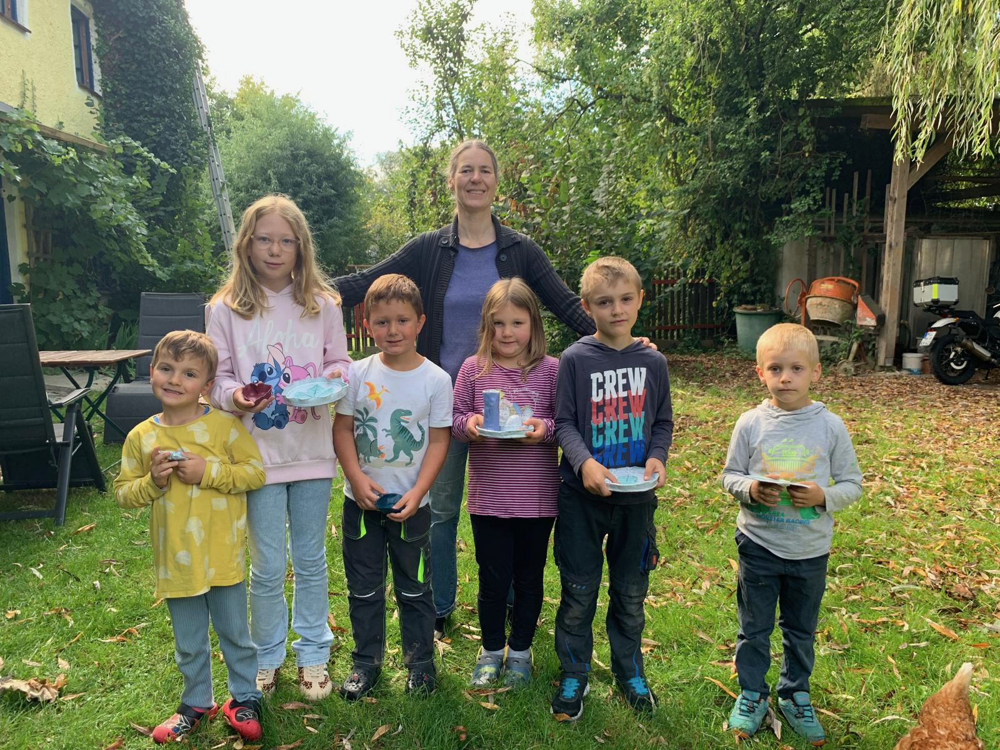
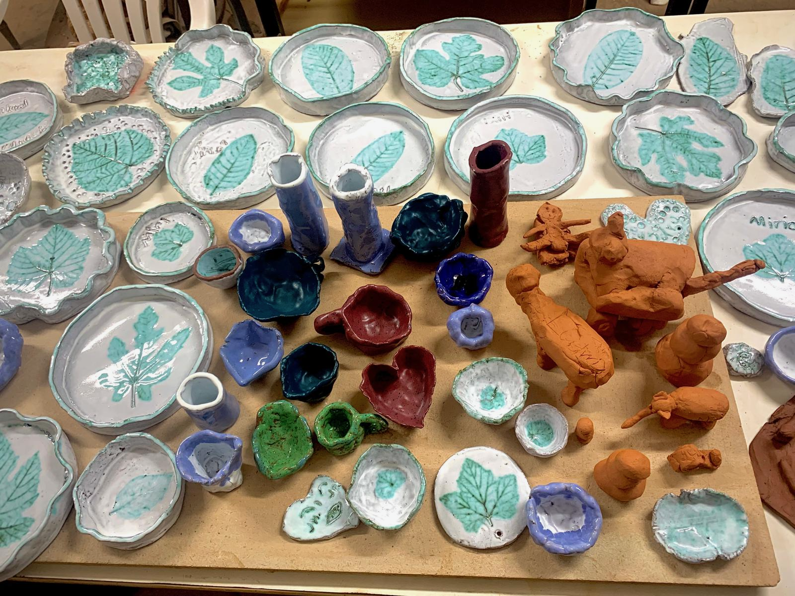

# Ferienprogramm: Kleine Kunstwerke aus Ton

Beim Ferienprogramm wurde mit viel Freude geknetet, geformt und gestaltet. Die Kinder verwandelten den Ton in Schalen, Teller, Figuren und viele ganz persönliche Kunstwerke.

Nach dem Trocknen und Brennen erhielten die Stücke ihre Farben. Besonders schön sind die Blattmotive, die viele Teller und Schalen zu unverwechselbaren Einzelstücken machen.

So entstanden aus einem gemeinsamen Nachmittag viele kleine Erinnerungen, die sicher noch lange Freude machen.
