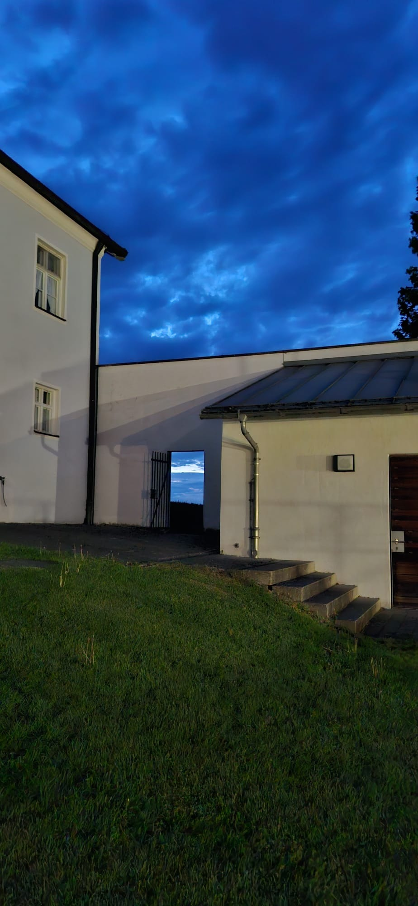

# Pfarrhof bei Nacht

Wenn der Tag langsam zu Ende geht, zeigt sich der Pfarrhof von einer ganz besonderen Seite. Die weißen Mauern heben sich deutlich vom tiefblauen Abendhimmel ab, über den dunkle Wolken ziehen.

Durch das offene Tor fällt der Blick noch einmal hinaus in die Weite. Für einen stillen Moment wirkt der vertraute Pfarrhof beinahe geheimnisvoll – ein ruhiger Ort zwischen dem letzten Licht des Tages und der beginnenden Nacht.
