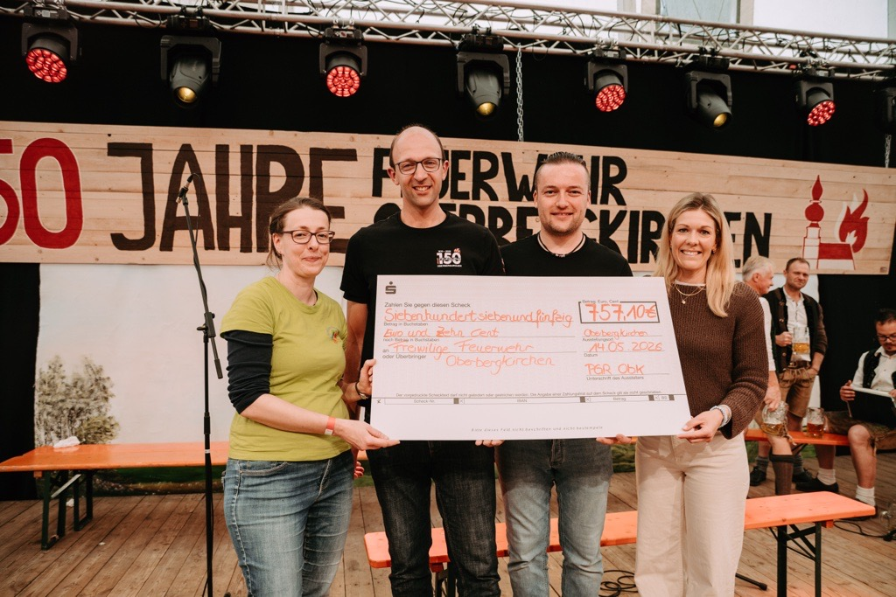

# Spende zum 150-jährigen Feuerwehrjubiläum

Beim Feuerwehrfest zum 150-jährigen Jubiläum wurde der Freiwilligen Feuerwehr Oberbergkirchen ein Spendenscheck über 757,10 Euro überreicht.

Das Geld war bei der Sammlung zum Fastenessen zusammengekommen. Mit der Spende würdigt der Pfarrgemeinderat den wertvollen Einsatz der Feuerwehr für die Menschen in Oberbergkirchen.
